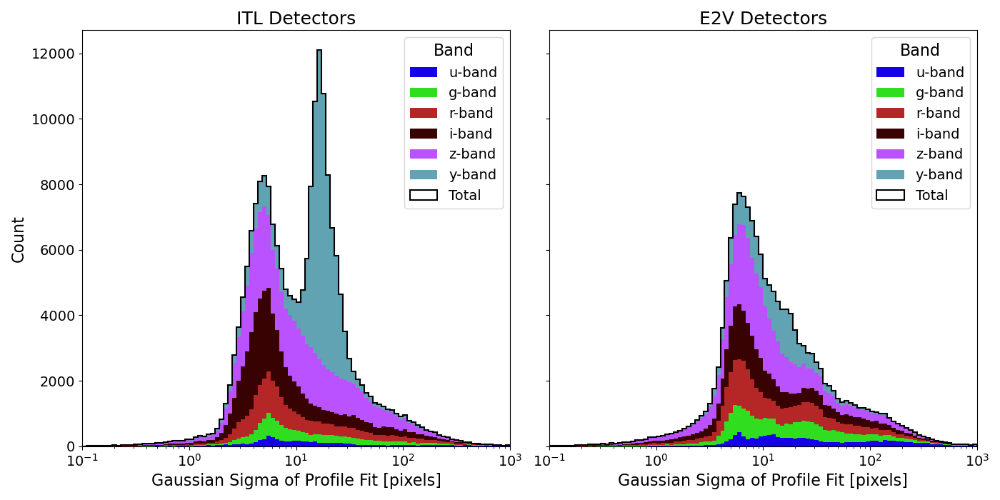
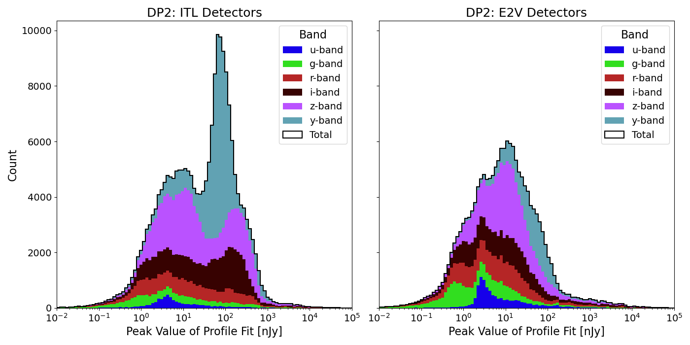

#########################
Streaks and Glints in DP2
#########################

.. abstract::

   We describe the detected streaks and glints in difference images and
   DiaSource catalogs in Data Preview 2, and comment on plans to improve
   detections in future data releases.

Add content here
================

In the Data Release Pipelines (DRP), the detection and analysis of trailed
objects is performed during the detection and measurement phase of the
difference image analysis (DIA). 

Linear Feature Detection
========================

The existing linear feature detection algorithm is implemented in the task
`lsst.meas.algorithms.MaskStreaksTask`, which is a subtask executed during the
`lsst.diffim.DetectAndMeasureTask` pipetask. The underlying feature detection
uses the Kernel-Based Hough Transform (KHT) methodology, which is a variation of
the standard Hough transform used in computer vision. By clustering
approximately colinear pixels, rather than directly summing all pixels in the
image array, the KHT achieves exceptional real-time speeds even for the large
LSSTCam detector images. Outside of the feature detection, there are additional
pre- and post-processing steps. These individual steps, as they pertain to the
DRP, are described in greater detail in the following subsections.

.. _sec-preprocessing:

Preprocessing
-------------

The Hough transform operates only on a binary array; preprocessing steps are
devoted to constructing this from the inputs. Within the DRP, the first steps
are specific to the overarching `DetectAndMeasureTask` and occur after source
detection, whereby the DETECTED mask plane has been set based on the source
detection threshold configuration. It is the DETECTED mask plane of the
difference exposure that serves as the binary array. However, the SNR of dim
streaks is first increased by binning:
1. A copy of the `maskedImage` associated with the exposure is made.
2. From this, a binned `maskedImage` is created by binning by the configurable
factor.
3. Any existing DETECTED mask plane in this binned `maskedImage` is cleared and
replaced by rerunning the source detection subtask to set a new DETECTED mask
plane.
4. The new DETECTED mask plane is rescaled to the original, unbinned dimensions.
5. This rescaled DETECTED mask plane is joined via logical OR with the original
DETECTED mask plane attached to the copy from Step 1.
6. The `maskedImage` copy, with the combined DETECTED mask plane is passed as
the input to the `MaskStreaks` subtask.

.. _sec-detection:

Detection
---------

Within `MaskStreaks` itself, the DETECTED mask plane is converted to a binary
array and then edge-thinned using the standard Canny edge filter implementation
in `scikit-image`. A configurable list of additional bad mask planes
(`["NO_DATA", "INTRP", "BAD", "SAT", "EDGE"]` by default) is merged into a
single bad pixel mask and dilated by 1. This is used to mask the edge-thinned
binary array.

The KHT implementation is a fork of the github.com/laffernandes/kht repository,
with minor modification. It is importable as `lsst.kht` and all configurable
arguments (included an absolute minimum and relative minimum threshold) are
exposed in `MaskStreaksConfig`. The results are Hesse normal form rho-theta
pairs that parametrize lines in the image centered frame. Because the KHT was
run on an edge-thinned binary array, there are two line detections for each
streak feature corresponding to the boundaries that must be merged using a
cluster algorithm to produce the first-pass streak detection results.

Postprocess
-----------

The initial streak detection results are refined by an iterative fit to a model
of the streak with a Gaussian cross-section. The procedure, per streak, is as
follows:
1. Pixel values within an initial distance from the line orientation of each
streak that were originally flagged as DETECTED are used in the model fit.
2. The line orientation of the best fit is taken and used as the input of the
next iteration.
3. This process repeats until convergence metrics are met. The final iteration
provides the refined streak detection result, augmented by its best fit
model sigma parameter and maximum value.

The sigma value of each result sets the distance from every refined line
orientation that pixels are flagged and set as the STREAK mask plane in the
original difference exposure. The refined streak results can be optionally
output as a `ArrowNumpyDict` containing the rho, theta, sigma, and model maximum
lists, but are not as default in DP2.

Streak Detection in DP2
=======================

Although the individual parameters associated with each detected streak are not
an output dataset of DP2, the STREAK mask plane that is set in the difference
images can propogate to the final data products. Therefore we specifically
re-ran the subset of the DRP pipeline necessary to recreate and save them to
study the underlying streak detections from which the STREAK mask plane was
derived.

The number of detected streaks per visit is shown in the following table, both
separated by band, and as a cumulative total.

.. _tab-dp2-streaks:

.. table:: Streak per Visit

   ====== ======= ====== =================
   Filter Streaks Visits Streaks per Visit
   ====== ======= ====== =================
   u-band 16167   3433   4.7
   g-band 40072   6248   6.4
   r-band 54111   8345   6.5 
   i-band 69380   9693   7.2
   z-band 108166  7118   15.2
   Y-band 98661   4672   21.1
   All    386557  39509  9.8
   ====== ======= ====== =================

There is a substantial increase in the number of detected streaks per visit in
z-band and Y-band visits. Based on the canonical reflectivity properties of the
surfaces of orbiting objects and the spectral energy distribution of the
illumination from the Sun, it was expected that the greatest number of bright
streaks would be observed in g-band or r-band. An investigation of this
discrepancy and the underlying cause of the increase in detected streaks at
long wavelengths is presented in :ref:`sec-dm-56055`.

The sigma and model maximum values serve as proxies for the widths and
brightnesses of the streaks, respectively. These are shown in 
:ref:`fig-dp2-streak-sigmas` and :ref:`fig-dp2-streak-maximums`.

.. _fig-dp2-streak-sigmas:

   Stacked histograms (per-band) of the Gaussian sigmas values, in pixels.

A distinct population of streak detections is observed in only detectors of the
ITL type in the Y-band results. Outside of this obvious feature, there are a
few other smaller populations that appear to be unique to one detector type or
another.

.. _fig-dp2-streak-maximums:

   Stacked histograms (per-band) of the Gaussian maximum values, in nano-Jansky.

Again, the dominant feature is the large population of streak detections that is
observed for Y-band exposures from ITL detectors. This population of streak
detections is the cause of the unexpected increase in streaks per visit observed
in :ref:`tab-dp2-streaks`. 

Identified Improvements
=======================

The DP2 streak detection results identified several areas for improvement. Based
on the default configurations, it was known that a small number of false streak
detections would be caused by a specific sensor effect native to only ITL
detector types (:ref:`sec-dm-xxxxx`). However the large population of additional
streak detections in Y-band images acquired by ITL detectors warrented further
investigation of the possibility of an additional sensor effect producing linear
features that was not accounted for during construction of the pixel mask. The
following tickets created in response to the immediately actionable areas for 
improvement are summarized in the proceding sections.

DM-52769
--------

The masking of regions around bright stars in streak detection was contingent on
the completion of DM-52541, which is to develop a new SPIKE mask plane to flag
pixel regions close to saturated stars. As this was marked "Done" as of the
beginning of 2026, this ticket was resolved by removing the temporary workaround
(consisting of a dilation of the bad mask array near saturated stars) and adding
the SPIKE mask plane to the list of bad mask planes.

.. _sec-dm-56055:

DM-56055
--------

Following an investigation into the subpopulation of streak detections, it was
discovered that the features occurred at the edges of images. At longer
wavelengths, reflection off the detector boundaries produce regions of elevated
signal along the edges, that trigger false detections. Although originally this
region was flagged as the EDGE mask plane, it is not excluded from the source
detection task that sets the original DETECTED mask plane, nor is it excluded
from the source detection task that sets the binned DETECTED mask plane. The
result is that the process of dilating the combined DETECTED mask plane in
:ref:`sec-preprocessing` then spreads the influence of the pathological pixel
values of this region outside the original flagged pixel region.

This ticket was resolved by changing the dilation of the bad pixel mask array in
:ref:`sec-detection` from a static value of 1 to a configurable parameter. The
default value was set to 10, as this was minimum dilation required to fully
exclude the influence of the edge glow features.

.. _sec-dm-xxxxx:

DM-XXXXX
--------

An instrumental effect known as "ITL dips" causes regions along columns in ITL
detectors to exhibit a coherent decrease in pixel values, resulting in a linear
feature. To prevent false streak detections associated with the features, these
regions should be masked using the existing model for the ITL dips. This ticket
was resolved by adding the ITL_DIP mask plane derived from the ITL dip
instrumental effect model to the list of bad mask planes.

Glint Detection in DP2
======================

Describe glint detection in dp2.
